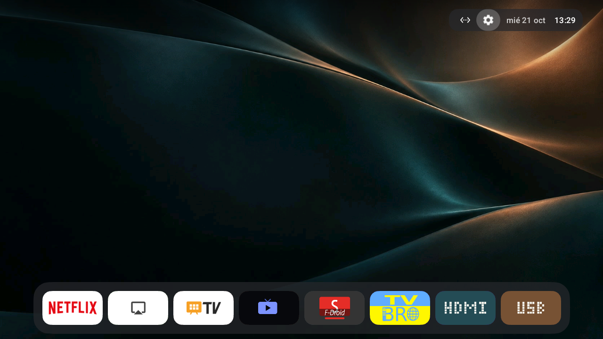

# Grunkel LED-3211GOO

[English](README.md) · [Español](README.es.md) · [Русский](README.ru.md)

**1.0.0 · first stable configuration toolkit for the tested Grunkel LED-3211GOO.** Browser, Netflix, YouTube alternative, internet TV, phone casting, HDMI/AV access and an offline USB photo screensaver. This configures the installed Android OS; it is not replacement firmware.



[Previous Projectivy home-es.png — preserved original](assets/screenshots/home-es.png). Only these two unedited screenshots and the reusable JPEG are kept publicly; provenance: [assets/showcase.json](assets/showcase.json).

## Choose one of three launchers

These are alternative home menus, not three TV models. Two have multilingual settings; Plume 1.3 is English-only. Versions are pinned to what was tested, with SHA-256 in [apps.lock.json](apps.lock.json).

| Launcher | Settings languages | Wallpaper/themes | Main nuance | Official release / APK |
| --- | --- | --- | --- | --- |
| Couchy 1.0.6 · current default | RU / ES / EN¹ | Free local JPEG; light/dark switch unverified | Eight-card Dock; JSON import/export | [Release](https://github.com/conreo/couchy-launcher/releases/tag/v1.0.6) · [APK](https://github.com/conreo/couchy-launcher/releases/download/v1.0.6/Couchy-Launcher-v1.0.6.apk) |
| Projectivy 4.72 | RU / ES / EN checked | Custom JPEG/themes required Premium on this version | Previous input row and settings retained | [Release](https://github.com/spocky/miproja1/releases/tag/4.72) · [APK](https://github.com/spocky/miproja1/releases/download/4.72/ProjectivyLauncher-4.72-c97-xda-release.apk) |
| Plume 1.3 | English settings only | Free local JPEG and Light / Dark / Auto | Alternative if English settings are acceptable | [Release](https://github.com/aradhyas8/Plume_Launcher/releases/tag/v1.3) · [APK](https://github.com/aradhyas8/Plume_Launcher/releases/download/v1.3/Plume-1.3.apk) |

¹ Couchy 1.0.6 has Russian/Spanish in its language picker, but no explicit English item. English was checked using the native per-app locale and JSON `"language": "en"`; see the language section. Source catalogs are not a full translation-quality audit. Official latest-release links still resolved to these three pinned versions on 2026-10-21; no automatic upgrades were made.

<a id="tv-specifications"></a>

## TV specifications

Facts below were observed on one unit on **2026-10-21**, not copied from a retail listing. Sources and exact calculations: [hardware.json](hardware.json). Available RAM/storage are dated snapshots; screenshot/display mode does not establish the physical panel resolution.

| Characteristic                 | Observed value                                    | Source                   |
| ------------------------------ | ------------------------------------------------- | ------------------------ |
| Model / screen                 | Grunkel LED-3211GOO · 32-inch LED TV              | [label](hardware.json)   |
| Power input                    | 100–240 V AC · 50/60 Hz                           | [label](hardware.json)   |
| Rated consumption / USB output | 56 W rating · USB 5 V / 0.5 A                     | [label](hardware.json)   |
| Android device / manufacturer  | Grunkel 2K Android TV · Expressluck               | [getprop](hardware.json) |
| Board / platform               | `martin` / MediaTek `mt5867`                      | [getprop](hardware.json) |
| Logical processors             | 4 entries: `0`, `1`, `2`, `3`                     | [cpuinfo](hardware.json) |
| Operating system               | Android 14 · API 34 · reported patch `2026-06-01` | [getprop](hardware.json) |
| Android application ABI        | 32-bit Android · `armeabi-v7a`, `armeabi`         | [getprop](hardware.json) |
| RAM reported to the kernel     | 935352 KiB ≈ 913.43 MiB (`935352 / 1024`)         | [meminfo](hardware.json) |
| Writable data partition | 4205976 KiB ≈ 4.011 GiB (`KiB / 1048576`) | [runtime-storage](hardware.json) |
| Available data space, snapshot | 2550860 KiB ≈ 2.433 GiB · 60.65% | [runtime-storage](hardware.json) |
| Available RAM, snapshot | 240228 KiB ≈ 234.60 MiB (`KiB / 1024`) | [runtime-storage](hardware.json) |
| Swap capacity | 716796 KiB ≈ 700.00 MiB; not physical RAM | [runtime-storage](hardware.json) |
| CPU frequency policy | 0.75–1.50 GHz available; scaling cap 1.45 GHz; unchanged | [cpu-frequency](hardware.json) |
| Android internal display mode | 1280 × 720, approximately 60 Hz; panel specification unverified | [display-runtime](hardware.json) |
| Factory low-RAM flag | `ro.config.low_ram=true` | [properties-runtime](hardware.json) |
| Current language / timezone | `es-ES` / `Europe/Madrid`; reset default unverified | [properties-runtime](hardware.json) |
| Captured UI dimensions         | 1280 × 720 px; not a panel specification          | [capture](hardware.json) |
| Boot state                     | Bootloader `locked` · verified boot `green`       | [getprop](hardware.json) |

<a id="compatibility"></a>

## Compatibility

Target: Expressluck / `martin` / MediaTek `mt5867`, Android 14 / API 34. The exact build fingerprint is pinned in [the profile](profiles/martin-mt5867-android14.json). `doctor` refuses a different board/build. Do not edit the guard just to force installation. Matching retail names do not establish compatibility.

This is a tested configuration baseline for one unit, not a universally tested ROM. Factory reset survival, Spanish after reset, complete Netflix playback and the full 30-minute photo/sleep cycle are not established. See [verification.json](verification.json).

<a id="technology-stack"></a>

## Technology stack

Python **3.9+** standard library + GNU Make + official Google ADB. Optional original Android apps are plain Java compiled with pinned local JDK/Android tools. Node/npm is optional metadata/wrappers; no npm dependencies. The automatic Android build-tool bootstrap is pinned for **macOS arm64**; other hosts need a compatible manual toolchain (`--toolchain`). Only macOS was exercised end-to-end.

Sources: [ADB](https://developer.android.com/tools/adb), [tool pins](android/photos/toolchain.lock.json), [contributor guide](CONTRIBUTING.md).

<a id="configured-applications"></a>

## Configured applications

| Component | Pinned version / role |
| --- | --- |
| One selected launcher | Couchy 1.0.6, Projectivy 4.72 or Plume 1.3 |
| SmartTube F-Droid | 32.56 / 2446; public YouTube video played without Google login |
| OpenTV | 0.11.7; authorized M3U internet channels |
| AirPlay Server | 0.0.36; iPhone mirroring receiver |
| TV Bro | 2.1.6; WebView browser for the remote |
| Netflix / Live TV | Factory apps retained; Netflix needs its own account |
| Grunkel Photos | Original 0.2.0; optional offline USB photo picker/screensaver |
| HDMI + USB cards | Original 0.1.0; optional offline shortcuts, no permissions |
| Material Files | Optional 1.7.5 picker for Couchy JPEG/JSON on this firmware |

The base install contains **one launcher + four common apps**, never all three launchers. Original Photos and HDMI/USB apps are separate optional builds. APK download links/hashes for every third-party app are in [apps.lock.json](apps.lock.json).

<a id="quick-start"></a>

## Quick start: initialize one launcher

On the TV enable developer options/USB debugging, authorize only your computer's key and determine the exact ADB serial/address. USB debugging does not prove that a TV USB socket supports a direct PC cable; do not use an arbitrary USB-A–USB-A cable. For wireless pairing follow the official [ADB instructions](https://developer.android.com/tools/adb).

Run from the project folder. **Replace `TV_ADDRESS:5555` in every command** with your authorized network ADB address, or use the exact USB serial. Python 3 and Make must already exist. Choose **one block only**; finish the welcome UI between `menu` and `configure`.

### Couchy: multilingual settings and free wallpaper

```sh
make install TV=TV_ADDRESS:5555 LAUNCHER=couchy
make menu TV=TV_ADDRESS:5555 LAUNCHER=couchy
# Finish Couchy's welcome on the TV.
make configure TV=TV_ADDRESS:5555 LAUNCHER=couchy
```

### Projectivy: multilingual settings; custom wallpaper is Premium

```sh
make install TV=TV_ADDRESS:5555 LAUNCHER=projectivy
make menu TV=TV_ADDRESS:5555 LAUNCHER=projectivy
# Finish Projectivy's welcome on the TV.
make configure TV=TV_ADDRESS:5555 LAUNCHER=projectivy
```

### Plume: English settings; free wallpaper/light/dark

```sh
make install TV=TV_ADDRESS:5555 LAUNCHER=plume
make menu TV=TV_ADDRESS:5555 LAUNCHER=plume
# Finish Plume's welcome on the TV.
make configure TV=TV_ADDRESS:5555 LAUNCHER=plume
```

`install` prepares official ADB, connects, guards the hardware and checks downloaded/installed SHA-256. `configure` applies the reversible profile, AirPlay/HOME and APK-request default-off policy, verifies, then opens the menu. Steps stop on failure and stay ordered with `make -j`.

For a prepared TV use `make setup TV=TV_ADDRESS:5555 LAUNCHER=couchy`; this does not complete welcome, import private layouts, choose playlists or select photo folders. Optional private address file: copy [device.example.json](device.example.json) to `device.local.json`. No network scanning is performed. `make plan` is read-only.

<a id="menu-languages-and-clock"></a>

## Menu, languages and clock

Current HOME is **Couchy**, with Netflix, AirPlay, Live TV, OpenTV, SmartTube, TV Bro, HDMI and USB in one Dock row. In Display choose **XS** icon size for all eight cards. Date and 24-hour clock use the retained TV timezone; Android and Couchy are currently Spanish.

To change only the launcher on an already prepared TV, substitute one name (`couchy`, `projectivy` or `plume`):

```sh
make launcher-list
make launcher-install TV=TV_ADDRESS:5555 LAUNCHER=plume
make menu TV=TV_ADDRESS:5555 LAUNCHER=plume
# Complete welcome before selecting HOME.
make launcher-use TV=TV_ADDRESS:5555 LAUNCHER=plume
make verify TV=TV_ADDRESS:5555
```

Install/preview do not select HOME. A successful `launcher-use` remembers it privately per serial/fingerprint in `launcher.local.json`. Priority: `--launcher` → `GRUNKEL_LAUNCHER`/Make `LAUNCHER` → saved choice → profile default Couchy. Rollback journals retain the original HOME and local choice.

**Languages:** Android retains RU/ES/EN. Projectivy's three translations were checked. Plume 1.3 settings remain English. Couchy Language offers Russian/Spanish; English works through Android per-app locale or a native configuration import with `"language": "en"`. Switching to System default after language trials left a stale Russian date/UI; explicitly choosing Español corrected it. Check both date and settings after a language change.

**Wallpaper:** [satin-teal-copper.jpg](img/satin-teal-copper.jpg) is a static internal JPEG, independent of USB. In Couchy select it through the photo picker; video/aerial backgrounds stay off. The factory picker is a stub, so optional Material Files was used. Install with `download-apps files` / `install files` through the Python CLI, then review `make files-access-status`; use `make files-access-on` only with owner-authorized shared/attached-storage access. It can modify files as well as read them. `files-access-off` revokes access; exact prior mode is journaled. No laptop share is mounted. Full examples: [technical reference](docs/technical-reference.md).

<a id="internet-tv-and-casting"></a>

## Internet TV and casting

OpenTV: Add source → Enter on TV instead → M3U playlist URL. The tested source was `https://www.tdtchannels.com/lists/tv.m3u8` from [TDTChannels](https://www.tdtchannels.com/listas/); La 1 played. It is mainly Spanish; a complete RU/EN channel offering is not configured. Use only playlists you are authorized to access.

For iPhone use the same LAN → Control Center → Screen Mirroring → Grunkel → TV PIN. The owner confirmed mirroring; AirPlay is set to 720p/30fps. Redmi 15C **YouTube casting** also worked; full Android screen mirroring was not proven. Native Google Cast/Play services remain. DRM-protected Netflix content should use the native app; no Netflix playback was verified. SmartTube played a public video without Google login.

<a id="tv-and-inputs"></a>

## USB files, photos and physical inputs

Add the two original cards and optional photo app:

```sh
make shortcuts-install TV=TV_ADDRESS:5555
make photos-install TV=TV_ADDRESS:5555
make shortcuts-status TV=TV_ADDRESS:5555
make photos-choose TV=TV_ADDRESS:5555
# Select the drive/folder with arrows + OK; BACK returns.
make photos-apply TV=TV_ADDRESS:5555
make photos-status TV=TV_ADDRESS:5555
```

**HDMI card:** lists actual registered HDMI 1–3 and AV; selection opens the factory TV app. HDMI 1 selection was verified through its active input session. Other external pictures were not newly verified. INPUT/SOURCE or `make inputs` remains available. No channel scan/deletion is performed.

**USB card:** opens the native file browser or existing photo-folder picker. Without a mounted drive the page's browse/photo buttons turn grey/disabled; the HOME tile itself stays visible. Actual owner removal/reinsertion updated the page automatically and restored access to the same photo folder. The helpers request no permissions, run no service and perform no USB writes.

**Photo policy:** 5 minutes idle → 25 minutes photos → sleep at minute 30; image interval **30 seconds**. Choose a folder with direct image files. Arrows/OK/BACK navigate; preview ←/→ changes images, OK pauses, BACK exits. Corrupt/unsupported decodes are skipped; JPEG/PNG were checked. Max 1000 candidates, decode up to 1280×720. Manual preview holds awake and is not the automatic cycle. Full-duration/reboot persistence is untested; active HDMI/media may hold the TV awake. Preserve photo signing keys for updates.

<a id="project-structure"></a>

## Project structure

Start with [AGENTS.md](AGENTS.md) (current state/invariants), then [verification.json](verification.json) (dated evidence/limits). [CONTRIBUTING.md](CONTRIBUTING.md) explains offline validation and pin updates; [CHANGELOG.md](CHANGELOG.md) describes 1.0.0.

```text
README{,.es,.ru}.md       user guides and launcher initialization
docs/technical-reference.md  advanced/recovery/remote commands
hardware.json            sourced facts; no nominal specs invented
verification.json        compact tested state and limitations
apps.lock.json           official APK URLs, versions and SHA-256
profiles/                exact hardware/build guard and reversible policy
scripts/                 ADB CLI, builds, offline check and safe export
android/photos/          original offline USB photo app
android/shortcuts/        original HDMI/USB cards, EN/ES/RU
assets/screenshots/       current Couchy + preserved old home-es.png
img/                     reusable static JPEG wallpaper
```

`tools/`, `downloads/`, private screenshots/logs/keys, `*.local.json`, backups and exports are ignored. Do not publish the whole workspace. The public exporter is an explicit file/hash whitelist.

<a id="privacy-and-performance"></a>

## Privacy and performance

The profile disables 13 reviewed optional packages, shortens animations and retains Cast, DRM, WebView, TV/input services and updates. It does not delete firmware APKs or increase RAM. Optional apps were only cache-cleaned at the owner's request; no app/update removal is part of setup.

**Zero telemetry and a permanent speedup are not established.** Vendor ACR remained running; streaming apps contact providers. Browser incognito does not provide anonymity. Never increase volume beyond the owner's cap **1/100**; use mute for checks.

Manual APK requests stay off for installed Projectivy, Plume, TV Bro and Material Files. `make installer-on` permits only optional Projectivy; use `make installer-off` afterwards. System installer/ADB are retained. Native storage grants and unknown-app installation are separate controls.

<a id="recovery-and-maintenance"></a>

## Recovery and maintenance

```sh
make check                         # Offline only: source/docs/JSON/XML/export integrity.
make verify TV=TV_ADDRESS:5555      # Read-only live profile/HOME/pinned APK checks.
make storage TV=TV_ADDRESS:5555     # Dated RAM/data snapshot; no cleanup.
make rollback TV=TV_ADDRESS:5555 JOURNAL=backups/FOLDER/changes.json
make stock-home TV=TV_ADDRESS:5555 # Explicit factory HOME; installed app data retained.
make export OUTPUT=exports/NEW_NAME.zip
```

Review drift before reapplying. `com.cltv.fast` and error-report settings reverted in earlier checks; cause is unproven. Journals must match the original device and are restored in reverse order. They do not uninstall new apps or reverse every manual UI choice. A factory reset removes this user configuration; no kernel/partition modification or reset-resistant Spanish default was implemented.

Couchy Save configuration wrote `Download/CouchyBackup.json`; Load worked via Material Files. Keep it private (package inventory) and keep the original JPEG separately. Plume APK/state reserves are not private app-data or full firmware images.

Laptop HID mouse/keyboard control worked with optional `make screen-bootstrap` then `make screen`; audio/clipboard sync are off. See the [technical reference](docs/technical-reference.md) for SSH, physical peripherals and recovery boundaries. This release-cleanup pass did not change TV settings. Git publication/commits are manual; see [CONTRIBUTING.md](CONTRIBUTING.md).

<a id="author"></a>

## Author

[Denis Gutsuliak (d9911.org)](https://t.me/d9911/) · [admin@d9911.org](mailto:admin@d9911.org). Author/contact metadata: [package.json](package.json).

<a id="license"></a>

## License

[GPL-3.0-or-later](LICENSE) for the original toolkit; see [NOTICE](NOTICE). Third-party applications, firmware, tools, UI/icons and trademarks retain their own rights. APKs, signing keys, accounts and private media are not distributed.
